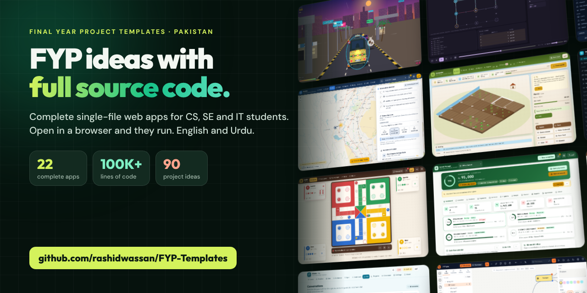

# FYP Templates: Final Year Project Ideas with Source Code

Free **final year project (FYP) templates with full source code** for computer science, software engineering and IT students in Pakistan. Each project is a complete web app in a single HTML file: open it in a browser and it runs, with no setup, no build step and offline support. Every app solves a real local (or globally useful) problem, ships with an English and Urdu interface, and deliberately leaves a documented set of features for you to build and defend in your viva.

**Live site:** [https://rashidwassan.github.io/FYP-Templates/](https://rashidwassan.github.io/FYP-Templates/) · **Project ideas:** [`IDEAS.md`](IDEAS.md) (90 FYP ideas) · **Student guide:** [funding, competitions, careers](#for-students-money-competitions-careers-tools)

Start with [`IDEAS.md`](IDEAS.md) for the full backlog of 90 ideas, or open [`index.html`](index.html) for a visual hub with a guided tour of the repository. Projects are numbered in build order; the idea number from the backlog is shown alongside.

## Projects

| # | Idea | Project | Folder | Lines | What it does |
|---|---|---|---|---:|---|
| 01 | #1 | Kisan Mandi Rate Board | `projects/01-kisan-mandi-rate-board` | 3,841 | Daily rates across 18 mandis, Sell Advisor, cost and profit calculator, mandi price map, seasonal analytics, store portfolio, buyer directory and SMS rate sheets |
| 02 | #4 | Crop Doctor | `projects/02-crop-doctor` | 5,273 | Offline leaf analyzer with a trainable TensorFlow.js model, field log, spray planner and dosage calculator, weather risk indices, outbreak map and a 34-entry pest and disease library |
| 03 | #11 | Dengue Watch | `projects/03-dengue-watch` | 4,552 | Outbreak dashboard, case line list with epidemic curve, larval survey indices, hospital board, campaign planner, WHO triage, fever diary and a school module |
| 04 | #12 | Khoon | `projects/04-khoon-blood-donor-network` | 4,330 | Compatibility-aware donor search, request lifecycle, pre-donation screening, donation camps, thalassemia rota, component matrices and demand analytics |
| 05 | #13 | Thalassemia Care Companion | `projects/05-thalassemia-care-companion` | 4,981 | Transfusion, ferritin and MRI iron tracking, labs, growth, chelation adherence, medicine refills, costs and support programmes, printable medical summary |
| 06 | #15 | Dawai | `projects/06-dawai-generic-finder` | 4,878 | 69 molecules and 220 brands with cheapest equivalents, drug information, prescription digitiser, family alerts, antibiotic stewardship and a cabinet expiry tracker |
| 07 | #16 | LHW Field Visit Assistant | `projects/07-lhw-field-visit-assistant` | 5,031 | Offline maternal and child register, ANC and EPI schedules, family planning, MUAC nutrition, TB and malaria screening, supplies, supervisor dashboard and DHIS2 export |
| 08 | #25 | Ishara — PSL Learner | `projects/08-psl-sign-language-learner` | 4,067 | 123 PSL signs with animated schematics, Urdu fingerspelling, sentence builder, conversations, SRS quiz, webcam practice and classroom mode |
| 09 | #26 | Board Exam Revision Planner | `projects/09-board-exam-revision-planner` | 4,409 | Per-board chapter weightage, interleaved weekly planner, SM-2 revision, flashcards, mock exams, datesheet countdown and guardian reports |
| 10 | #27 | Virtual Science Lab | `projects/10-virtual-science-lab` | 7,856 | Fourteen canvas experiments across physics, chemistry and biology with measurement tools, readings and regression, worksheets, quiz bank and teacher mode |
| 11 | #39 | Sailab — Flood Preparedness | `projects/11-sailab-flood-preparedness` | 4,019 | District flood risk from river gauges and rain, evacuation routes, relief camps with supplies and volunteers, missing-person matching and flood history |
| 12 | #43 | Kameti Manager | `projects/12-kameti-committee-manager` | 3,971 | Rotating savings committees with payments matrix, lottery and need-based payouts, late fees, disputes, receipts, savings planner and printable agreements |
| 13 | #51 | Privacy-First Password Manager | `projects/13-password-manager` | 3,571 | Zero-knowledge WebCrypto vault with five item types, TOTP codes, generator, explainable strength analysis, health audit and a hands-on crypto lab |
| 14 | #52 | Algorithm Visualizer | `projects/14-algorithm-visualizer` | 5,923 | Sorting, pathfinding, graph and data-structure labs on one step engine, plus a benchmark lab, glossary, quiz and printable lab reports |
| 15 | #56 | ATS-Friendly Resume Builder | `projects/15-resume-builder` | 5,699 | ATS-friendly CV templates with keyword scoring, application tracker, skills-gap analysis, interview prep, LinkedIn generator and an Urdu CV mode |
| 16 | #59 | Nuqta — Mind Map & Flowchart Editor | `projects/16-mindmap-flowchart-editor` | 4,868 | Mind maps and flowcharts with auto-layout, synced outline, presentation mode, comments, version history and Mermaid import and export |
| 17 | #60 | Client-Side Image Toolkit | `projects/17-image-toolkit` | 4,517 | Resize, crop, compress, convert, stamp and strip metadata in the browser, with passport presets, portal requirement checks and batch ZIP export |
| 18 | #66 | Ludo | `projects/18-ludo` | 4,498 | Classic Ludo with four AI levels including an expectimax Expert, round-robin tournaments, replay viewer, achievements, player statistics, a guided tutorial and custom boards |
| 19 | #74 | Rickshaw Rush | `projects/19-rickshaw-rush` | 4,214 | Pseudo-3D Karachi endless runner with passengers, fuel and traffic, a truck-art garage, seeded daily challenge with ghost replay and trip analytics |
| 20 | #77 | Zameendar | `projects/20-zameendar-farm-sim` | 3,927 | Sixty-month farm strategy game with canal water, soil health, pests, markets, bank and arhti credit, challenges and a season planner |
| 21 | #86 | PromptCraft | `projects/21-promptcraft` | 5,751 | Prompt engineering game: 30 levels judged by explainable rubrics, a playground with A/B tests and cost estimates, a prompt linter, lessons and optional live AI |
| 22 | #87 | CodeBuddy | `projects/22-codebuddy` | 9,655 | Coding mentor for kids: sandboxed JavaScript and Python, a step-through visualiser, turtle art, blocks to code, error help in Urdu and 24 lessons |
| 23 | #88 | CampusHub | `projects/23-campushub` | 7,130 | Campus portal: lost and found with map pins and verified claims, notices, events, timetable and free rooms, societies, ride share and moderated feedback |
| 24 | #89 | ScholarTrack | `projects/24-scholartrack` | 6,552 | 52 scholarships with an eligibility quiz, application pipeline, document vault, essay editor, referee templates, deadline calendar and funding calculator |
| 25 | #90 | FraudShield | `projects/25-fraudshield` | 7,238 | Scam checker for Urdu, Roman Urdu and English messages, links and job ads, plus from-scratch classifiers and an isolation-forest transaction lab |
| 26 | #46 | Karyana Khata | `projects/26-karyana-khata` | 6,818 | Urdu-first shop ledger: inventory, quick sale with thermal receipts, udhaar ledger with ageing and reminders, suppliers, cash book and profit and loss |
| 27 | #50 | Mahfooz | `projects/27-mahfooz` | 7,307 | Women's safety companion: press-and-hold SOS with location, safe journeys, fake call, an encrypted incident journal, rights guides and discreet mode |

All 27 projects are built: 144,876 lines of app code in total, between 3,571 and 9,655 lines each. Each folder has an `index.html` (the whole app) and a `README.md` (getting started, problem, features, architecture, domain logic, student extensions).

## Conventions

- **Single file, no build.** Vanilla JS, inline CSS, hand-drawn SVG charts. The only network dependencies are Google Fonts and, where noted, lazily loaded libraries (TensorFlow.js, Leaflet) that degrade gracefully offline.
- **Local-first.** State lives in `localStorage` under a per-project prefix; realistic seed data makes every app usable on first open.
- **Icons and motion.** Inline SVG icon sprites (no emoji chrome), page transitions, staggered lists, animated numbers and charts, all honouring `prefers-reduced-motion`.
- **Bilingual.** English with an Urdu toggle (Noto Nastaliq Urdu) wherever the audience is the Pakistani public.
- **Distinct design per project.** Different palette, typeface and layout pattern each time; shared only in a small internal skeleton (store, toast, router, chart helpers).
- **Student extension points.** `// TODO(student):` comments mark exact stub points; each app's About page and README list what is left to build and where to start.

## Running

Open any `projects/*/index.html` in Chrome, Edge, Firefox or Safari. For camera, geolocation and notification features serve the folder over HTTP (for example `python3 -m http.server`), since browsers restrict those on `file://`.

## For students: money, competitions, careers, tools

**Money and support**
- Ignite's NGIRI program funds prototypes with up to Rs 84,700 for equipment and Rs 12,100 for other costs; the national champion team wins Rs 400,000. Check whether your department is registered. ([ignite](https://ignite.org.pk/?p=2503))
- HEC's Innovator Seed Fund gave 28 university startups grants of up to Rs 10 million each in its 2022-23 round. Students and recent alumni can apply if their incubation centre endorses them and they register a company with SECP. ([hec](https://www.hec.gov.pk/english/news/news/Pages/28-University-Startups-Win-HEC-Innovator-Seed-Fund.aspx))
- Campus pitch funds: Rawalpindi Women University's 2025 pitch fest awarded Rs 9 million in seed funding; Punjab is setting up funding pools at each university. ([dawn](https://www.dawn.com/news/1960379))
- NIC Islamabad gives selected startups a year of free workspace and has run campus sessions on turning an FYP into a startup. ([startup.pk](https://www.startup.pk/nic-islamabad/), [bahria](https://archive.bahria.edu.pk/?p=14865))

**Competitions and recognition**
- P@SHA ICT Awards: the 2026 cycle closed on 10 August; winners go to APICTA in Jakarta in December 2026. Aim for the 2027 cycle. ([propakistani](https://propakistani.pk/2026/08/03/psha-opens-applications-for-22nd-ict-awards-winners-to-represent-pakistan-at-apicta-2026/))
- Microsoft Imagine Cup 2027: teams of up to four students, up to $5,000 in Azure credits, listed deadline 8 January 2027, world championship May 2027. ([imaginecup](https://imaginecup.microsoft.com/en-us/category/34))
- Ignite's national FYP championship has drawn winners from universities across Pakistan, not only the big-city ones. ([propakistani](https://propakistani.pk/2017/05/20/student-entrepreneurs-honored-national-competition-final-year-projects/))

**Jobs and careers**
- At IBA Karachi's June 2026 FYP exhibition several students received job offers and interview calls. ([iba](https://smcs.iba.edu.pk/iba-smcs-hosted-the-computer-science-final-year-project-fyp-exhibition-2026.php))
- 32.8 % of graduates aged 20–24 are unemployed (Gallup Pakistan on the 2024-25 Labour Force Survey); a strong FYP moves you up the queue. ([gallup](https://galluppakistandigitalanalytics.com/2026/07/24/in-pakistan-a-university-degree-can-mean-a-longer-wait-for-a-job-not-a-faster-one/))
- Employers say new graduates lack job skills; your FYP is the evidence that you are the exception. ([thenews](https://www.thenews.pk/tns/detail/1397528-the-point-of-education))
- AI is cutting demand for routine programming while opening roles in AI engineering, cybersecurity and cloud. A basic data-entry app no longer stands out. ([bloompakistan](https://bloompakistan.com/?p=163533))
- IT exports hit a record $4.6 billion in FY26 with a $10 billion target by FY29; freelancer earnings passed $1 billion with 2.37 million registered freelancers. A finished, deployed FYP is a portfolio piece clients can try. ([profit](https://profit.pakistantoday.com.pk/2026/07/18/pakistans-it-exports-hit-record-dollar46-billion-in-fy26-surpass-government-target), [outsourceaccelerator](https://news.outsourceaccelerator.com/pakistan-it-exports-record/))
- The National AI Policy's High-Tech Internship Program targets 20,000 placements a year plus 3,000 postgraduate scholarships. ([meatechwatch](https://meatechwatch.com/2025/10/03/pakistan-launches-national-ai-policy-2025-with-goal-to-train-one-million-by-2030/))

**Tools**
- GPU access is the biggest limit for AI research in Pakistan; prefer ideas that run with small models on free Colab or Kaggle, or with APIs. ([geo](https://www.geo.tv/latest/611676-pakistani-students-revolutionary-geogemma-project-wins-top-google-award))
- Under the August 2026 Pakistan–Google agreement students get a year of free Google AI Plus and Gemini; a payment method is required and it converts to paid unless cancelled. ([propakistani](https://propakistani.pk/2026/08/21/how-pakistani-students-can-get-free-gemini-subscription-for-1-year/))

## Contributing / PRs

Each project lands as its own pull request from a `claude/project-NN-slug` branch into `main`, containing only `projects/NN-slug/`.
